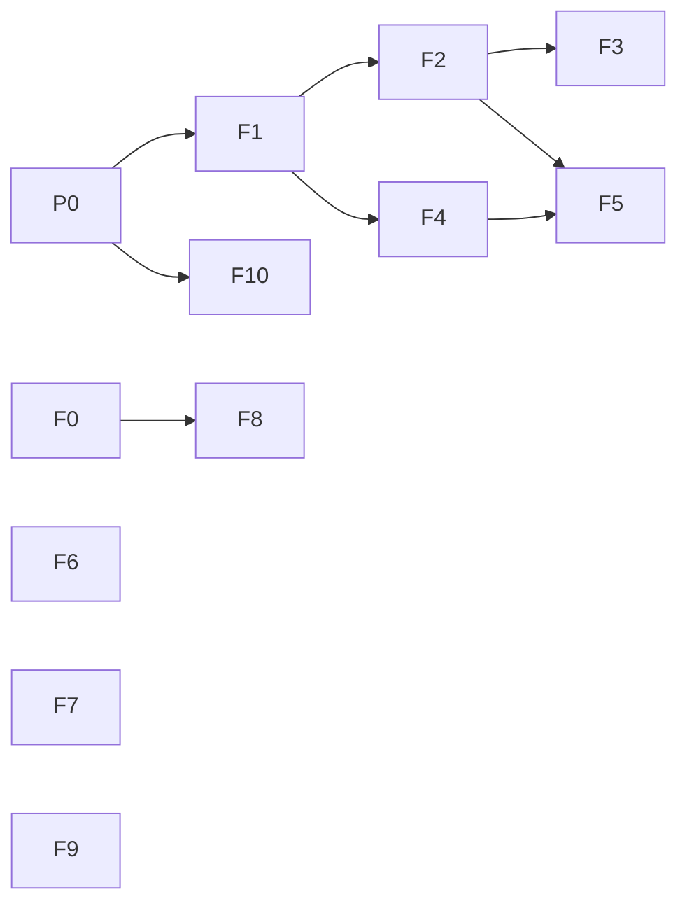

# V1.5 plan

Drafted 2026-11-22 against fork `main` @ `a9e3f6e`. Revalidated the same day against omp `19.1.0` (released 2026-11-21; the CLI on PATH is `omp 19.1.0`), which is the **minimum SDK for V1.5**. The fork still pins `18.18.0`; P0 ports it. SDK paths below are relative to `@oh-my-pi/pi-coding-agent@19.1.0/src/`.
Companion: `routines-v1-plan.md` §4.4, §5, §8.4, §8.6 (the original V1.5 scope); `CHANGELOG.md` 0.3.0 "What's deferred to V1.5".

## 0. Upstream review

| Ref | State |
|---|---|
| `upstream/main` (mcbarlowe/omp-deck) | `ea2a34f` — v0.5.0, 2026-05-28. **No commits since.** Issues disabled. |
| Fork `main` | 9 commits on top of `ea2a34f`: SDK 18.18.0 port, API-key providers tab, Host/Origin allow-list, routine secret scrubbing, orientation test sandboxing, starter-skill kanban sections, Graphify + Studio views. |
| Upstream PR #1 (@smkzw) | Open, unreviewed, 9 commits 2026-07-27 → 08-02. External CLI session live tails, JSONL delete/rename/archive, bridge auto-restart, reasoning picker, native folder chooser. **Touches no V1.5 item.** Merge-tree against fork `main`: one conflict, `apps/web/src/components/tools/ToolCallCard.tsx`. It also fixes the orientation test home-dir leak a second way (`mock.module` in the test vs our `f587028` in the store). |

Verdict: nothing upstream has moved on V1.5, so the plan proceeds on the fork. Adopting PR #1 is a separate decision. If it is adopted, land it before F10: both touch `reducer.ts`, `Chat.tsx` and the message renderers.

### omp (can1357/oh-my-pi)

| Item | State | Effect on V1.5 |
|---|---|---|
| Latest release | `19.1.0`, 2026-11-21. 21 releases since the fork's `18.18.0` pin (2026-11-07), including the 19.0.0 major. | New minimum. P0 ports the fork. |
| Published roadmap | None: no ROADMAP file, no milestones. Direction has to be read from the changelog and the `omp2` branch. | — |
| omp² (`omp2` branch) | Ground-up Rust rewrite ("port observable behavior, not TS shape"). Branch tip `2f92f3b`, 2026-09-04; `main` has kept shipping since. The only statement on timing is "active development, no ETA" (#9820, 2026-08-26). Whether it replaces `main`, and what happens to the `@oh-my-pi/*` npm SDK, is unanswered (#18808 open; #19813 closed without a maintainer reply). On the branch the npm package is a launcher (`npm/pi-coding-agent/bin/omp.js`), embedding is the Rust `omp-sdk` crate, and `crates/app` keeps the CLI, print, RPC and ACP adapters. | A cutover would remove `createAgentSession`, which the whole deck bridge is built on, not only V1.5. There is no date, so V1.5 does not wait for it. Every new SDK call in this plan sits behind `mcp-service.ts` (F1, F2) or `AgentBridge` (F4, F10). |
| 18.18.1 → 19.1.0 changelog | No cron, routine, webhook or event-trigger feature. MCP changed: servers are hosted as shared units, optionally in the per-user omp daemon, and the standalone transport and tool-cache exports are gone (19.1.0). RPC `bash` gained `excludeFromContext` (18.18.1). | Nothing replaces F6–F9. F1, F2 and F4 are updated below. |
| Upstream GUI | #5742 (web/desktop GUI) has been open since 2026-07-16 with no maintainer decision. Community clients build on `--mode rpc` (omp-gui, OmpCode) or a PTY (omp-studio). #20136 (2026-11-22) announces OMP-UI, a third-party kanban and cron board. | No upstream web UI is planned that would replace the deck. |

What each feature depends on, and what would survive without the TypeScript SDK:

| Feature | In-process SDK surface | Out-of-process equivalent in 19.1.0 |
|---|---|---|
| F1 `mcp` step | `MCPManager`, `callTool`, `listTools` | None. A host cannot call one MCP tool through the CLI, RPC or ACP. |
| F2 Integrations | `mcp/config-writer`, `mcp/config`, `mcp/oauth-reauth` | The `mcp.json` files on disk. No RPC surface. |
| F4 allowlists | `createAgentSession` (`skills`, `mcpManager`, `mcpTools`, `outputSchema`) | Partial. `omp -p --skills <globs> --mode json` covers skills and real usage. No flag, env var or settings key restricts MCP per server, and there is no output-schema flag. |
| F10 `!` / `$` | `AgentSession.executeBash` / `executePython` | RPC `bash` and `abort_bash` (no streaming, no Python). ACP has none. |
| F0, F6–F9 | none | — |

Verdict: with the edits marked "19.1.0" in each section, the plan holds on omp 19.1.0, and nothing in omp's known direction removes or supersedes a V1.5 item.

## 1. Scope

Tasks are tracked on the deck kanban; each card body is the handoff document for its item.

| # | Feature | Source | Depends on | Card |
|---|---|---|---|---|
| P0 | Port the fork to omp SDK 19.1.0 | new minimum SDK | — | T-8 |
| F0 | Fixes found during this review | this review | — | T-9 |
| F1 | Deck MCP service + real `mcp` step | CHANGELOG 0.3.0; `steps/mcp.ts` | P0 | T-12 |
| F2 | Integrations page + `/api/mcp` | plan §8.4; `IntegrationsView.tsx` stub | F1 | T-13 |
| F3 | MCP-aware step forms | plan §8.6 Tier 2 | F2 | T-15 |
| F4 | Enforce `skills_allowed` / `mcp_servers_allowed` on agent steps | CHANGELOG 0.3.0; `steps/agent.ts:6-9` | F1 | T-14 |
| F5 | Google Workspace integration + `inbox-triager` template | plan §4.4, §5.1-5.4 | F1, F2, F4 | T-16 |
| F6 | Form-mode DnD reorder + smart-reorder warnings + duplicate | plan §8.6 Tier 2; CHANGELOG 0.3.0 | — | T-17 |
| F7 | `event:` triggers | CHANGELOG 0.3.0; `TriggerPicker.tsx:3` | — | T-18 |
| F8 | Fix `queue` + add `max_parallel` | `concurrency.ts:7-8` | F0 | T-11 |
| F9 | Webhook registration correctness + collision surfacing | `routes-routines.ts:301-303` | — | T-10 |
| F10 | Composer `!bash` / `$python` (TUI parity) | CHANGELOG 0.3.0 (plan mode half shipped in 0.4.0) | P0 | T-19 |

Order: P0 → F0 → F9 → F8 → F1 → F2 → F4 → F3 → F5. F6 and F7 are independent of everything. F10 needs only P0. F0, F8 and F9 do not touch the SDK, so they can land before P0 if the port slips.

## 1a. P0 — Port to omp SDK 19.1.0

**Status** (2026-11-22): done. Results are under Acceptance.

**Current state**
- `apps/server/package.json:15-17` pins `@oh-my-pi/pi-ai`, `pi-coding-agent` and `pi-tui` at `18.18.0`.
- 19.1.0 declares `engines.bun >= 1.4.4`. The fork says `>=1.3.14` (`package.json:46`, `apps/server/package.json:29`), CI runs `1.3.14` (`.github/workflows/ci.yml` matrix), the image is `oven/bun:1.3.14` (`Dockerfile:25,47`) and `docs/install.md:17` documents `≥ 1.3.14`.
- Every deck import and SDK call was compared against the 19.1.0 source. All 15 import specifiers resolve for the typecheck, no imported symbol was removed, and `ExtensionUIContext` gained no required member. The deck uses none of the removed APIs: `hasPendingAsyncWork`, `settleAsyncWork`, `session.handoff`, `logoutCredential`, `cacheWarming: false`, `deferSkillDescriptionCompression`, `DeferredMCPTool`, the MCP transports. The package root still fails to load at runtime (change 3).

**Changes**
1. Bump the three SDK packages to `19.1.0` and Bun to `1.4.4` in the five places above. Refresh `bun.lock`.
2. Plan mode (`bridge/plan-mode-bridge.ts`). 19.1.0 submits a plan with the `propose` command instead of a `write` to `xd://propose`. When `bash` is not an active tool, `propose` is offered only if plan mode is already on when the tool set is rebuilt.
   - In `enter()`, call `setPlanModeState` before `setActiveToolsByName(planTools)`; if the rebuild throws, reset the state and rethrow. Set the proposal handler after the tools apply, as the TUI does.
   - In `exit()` (`:313-321`), clear both before restoring `previousTools`.
   - Keep adding `write` to the plan tools: the plan file is still drafted with it.
   - Update the `xd://propose` wording in the comments and in `plan-mode-bridge.test.ts:136`.
3. Backport upstream `295ea02a1` (#20058) with `bun patch`. 19.1.0's package root fails to import: `tools/browser/relay/native-host-manifest.ts` value-imports `NATIVE_HOST` from `packages/browser-relay`, which is not published. `patches/@oh-my-pi%2Fpi-coding-agent@19.1.0.patch` (registered in `package.json` `patchedDependencies`) inlines the constant, and the Dockerfile copies `patches/` before each `bun install`. Drop the patch with the first SDK release that contains the fix.
4. CI web build. Bun 1.4 runs `bun --cwd apps/web run build` as a bare `bun run`: it prints usage and exits 0 without building. Changed to `bun run --cwd apps/web build`.
5. `PLAN_APPROVED_PROMPT_TEMPLATE`: the SDK's `plan-mode-approved.md` is unchanged in 19.1.0; only the sync marker moved.

**Behaviour that changes without a code change**
- `agent_end` fires once per run, and `agent_pause` is new. The deck also handles `turn_end` everywhere it handles `agent_end`, and the web reducer ignores unknown events.
- `ask` is one HTML form. The deck has no `formDialog`, so it keeps getting one prompt per field through `select` / `input` / `editor`. `ExtUiBridge.select` drops the multi-select tick state (`checkedIndices`), as it already does on 18.18.0.
- Rarely used tools and MCP tools run as bash "tool commands" while `bash` is active (`tools.commands`, on by default), so chat shows them as `bash` calls.
- Chat sessions hold `mcp.shared` (on by default): their MCP servers are hosted by the per-user omp daemon when one is reachable, and in the deck process otherwise.

**Acceptance**
- `bun install --frozen-lockfile`, `bun run typecheck` and `bun test` pass on Bun 1.4.4.
- Manual: a chat turn streams and ends. A `/plan` round trip (enter, propose, approve) works. An `ask` dialog can be answered. `/mcp list` runs. Settings → Providers lists the OAuth providers.
- Result on Bun 1.4.4: frozen install, typecheck (4 workspaces), `bun test` (290 pass, including a new rollback test) and the web build pass. A boot smoke with an isolated DB created a session through `POST /api/sessions` (4 extensions, 0 errors), toggled plan mode over WS, ran `/mcp list` and listed 98 OAuth providers. On a real 19.1.0 session with `bash` inactive, the old order leaves `propose` unpresented and the new `enter()` presents it. Not run: a model turn, propose → approve, an `ask` dialog, and the Docker build (no daemon running).

**Risks**
- The typecheck needed no fixes but did not catch the broken package root; only loading the module did. Future bumps must boot the server, not just typecheck.
- omp shipped 21 releases in the 14 days after 18.18.0. Keep exact version pins and repeat this comparison before any later bump.

## 2. F0 — Fixes found during review

**Status** (2026-11-23): done; item 3 with F9 (`32aec83`), item 4 with F7 (`58e83c8`).

1. **Agent steps with `model:` always fail.** `steps/agent.ts:46-48` passes `-m`. omp has no `-m` flag: 19.1.0 accepts only `-e`, `-r`, `-c`, `-h`, `-v` and `-p` as short flags and exits with `Error: unknown flag: -m` (`cli/args.ts:522-531`; reproduced on 18.20.0). The shipped `daily-briefing` template sets `model: claude-sonnet-4-6` (line 60), so the V1 proof point is broken. Fix: use `--model`. F4 later replaces this code path, but ship the one-liner now.
2. **`queue` concurrency does not queue.** `fireV1` (`routines-runner.ts:184-219`) never awaits `decision.release`, so a queued run starts immediately. If it finishes before the active run, `finish()` runs its own queued thunk, which pushes the finished runId back into `active` where it stays forever. In practice `queue` is unbounded `parallel` with leaked entries. Fix: `if (decision.kind === "queue") await decision.release;` before `runV1Pipeline`. Regression test: `routines-runner.test.ts` (two fires of a `queue` routine take two `wait` durations and leave no controller entries).
3. **Webhook secret churn** and the **invalid random webhook path** (about 28% of generated paths start with a digit and fail `^/hooks/[a-z]…`) are fixed in F9.
4. **Docs drift.** `docs/tui-parity.md:63` lists `event` triggers as shipped, but they never fire. Fixed with F7.

## 3. F1 — Deck MCP service + real `mcp` step

**Status** (2026-11-23): done in `8116429`; end-to-end run on a live deck pending.

**Current state**
- `steps/mcp.ts:20-34` is a stub that always fails. Its workaround text points at `mcp_servers_allowed`, which `agent.ts` never reads.
- Schema, type, form and palette already exist: `step-mcp.json`, `protocol/src/index.ts:1433-1438`, `StepForms.tsx:552-597`, `spec-yaml.ts:215-216,395`.
- The deck server has no MCP code. Each chat session gets its own `MCPManager` by SDK default; `in-process.ts` throws away `result.mcpManager`.

**SDK surface** (19.1.0, `@oh-my-pi/pi-coding-agent/mcp`, exported):
- `new MCPManager(cwd, loadConfigs?, idleMs?, hostAccess?)`. The 18.x `toolCache` and reconnect-policy arguments are gone. Methods used here: `setAuthStorage`, `discoverAndConnect`, `getAllServerNames`, `getConnectionStatus`, `getServerRuntime`, `getSource`, `waitForConnection`, `reconnectServer`, `getTools`, `disconnectAll`.
- `callTool(conn, tool, args, {signal})` → `MCPToolCallResult {content, isError?, structuredContent?}`. `structuredContent` is `unknown` and can be `null`.
- `listTools(conn, {signal})` → `MCPToolDefinition[]` with the raw `inputSchema`. `getTools()` returns session tools with normalized parameters only, so schema validation and F2/F3 use `listTools`.
- The manager has no `callTool` of its own. `setAuthStorage` must be called before discovery so OAuth-backed HTTP servers resolve their tokens.
- Hosting changed in 19.1.0. Each server is a host unit. A server that speaks MCP 2026-07-28 is one unit shared by every manager; an older handshake-era server gets one unit per manager. Units live in the deck process, or in the per-user omp daemon once a chat session holds `mcp.shared` (on by default) and the daemon is reachable. Tool catalogs are cached on disk, so listing tools does not have to start a server.

**Design**
- New `apps/server/src/mcp-service.ts`. It owns one deck-level `MCPManager` with `cwd = config.defaultCwd` and `setAuthStorage(modelRegistry.authStorage)`, using the bridge's registry (`in-process.ts:108`). It connects lazily on first use.
  - API: `listServers()`, `listTools(server)`, `callTool(server, tool, args, signal)`, `reload()`, `dispose()`.
  - `callTool` calls `reconnectServer(server)` first if the status is not connected, then `callTool(await waitForConnection(server), …)`. Never pass `manual: true`: that stops the upstream, which other omp sessions may be sharing.
- Why one deck-level manager rather than connecting per call: F2 needs live status and tool catalogs, and F4 hands the same manager to headless sessions. The cost is lower than on 18.x. Only handshake-era servers get a second process for the deck's manager; modern servers are shared units.
- `executeMcpStep(step, context, signal, mcp)`:
  1. Render `args` with `deepRender`. Move it from `http.ts:123` into `template.ts` as an export so `http` and `mcp` share it.
  2. Validate the rendered args against the tool's `inputSchema` with Ajv, via a new `validateAgainstSchema` export in `protocol/validate.ts`. On error, fail without calling the tool.
  3. Map the result:
     - `isError` → failed.
     - `json` = `structuredContent` when it is not `null` or `undefined`, else the first text block if it parses as JSON, else the `content` array.
     - `stdout` = text blocks joined, clipped to the existing 8 KB excerpt cap.
  4. Don't retry or add a timeout inside the step. Per SDK #16429 a request that was sent and then dropped is non-retryable, and the existing step-level `on_failure: retry` covers retries. The SDK already applies a ten-minute tool-call deadline (longer while the server reports progress) and retries once after an expired HTTP session.
- Thread `mcp` through `runV1Pipeline` options to the dispatch at `v1-runner.ts:396-397`.
- Delete the stub text: `StepForms.tsx:558-561`, `spec-yaml.ts:395` help, `routines-v1-tutorial.md:212-216`, `.omp/agent/commands/create-routine.md:54`.

**Commits**
1. `mcp-service` and boot wiring, plus a test against a tiny fake stdio MCP server: a Bun script answering `initialize`, `tools/list` and `tools/call` (a handshake-era server, which 19.1.0 still supports).
2. `routines: real mcp step`, with tests for: JSON result mapping, `isError` → failed, schema-invalid args → failed with no call, unknown server → failed.
3. Remove stub copy in UI and docs.

**Acceptance**: a routine with `type: mcp` against the fake server exposes `steps.<id>.json` to a downstream `transform`. RunDetail shows stdout and json.

**Risks**
- `loadAllMCPConfigs` drops Exa servers by default (`filterExa`).
- Discovery is wider than `mcp.json`. Under `defaultCwd` it also loads `.omp/.mcp.json`, `mcp.json`, `.mcp.json` and the Claude, Cursor and VS Code MCP configs. Routines can call those servers too; F2 lists them read-only.
- OAuth HTTP servers need a stored credential, from `/mcp reauth` in chat or from F2's Reauthorize.
- Where a server runs depends on timing: a manager built before any chat session hosts it in the deck process, and later attaches go to the daemon. Calls work either way; only the owning process differs.

## 4. F2 — Integrations page + `/api/mcp`

**Status** (2026-11-23): done in `4613446`; live UI check pending.

**Current state**: `IntegrationsView.tsx` is a static placeholder (`router.tsx:13,26`, `NavRail.tsx:19`). There are no MCP routes.

**Design — `apps/server/src/routes-mcp.ts`** (behind the existing request guard):

| Route | Backing SDK call |
|---|---|
| `GET /api/mcp/servers` → `{name, scope, sourcePath?, transport, enabled, status, toolCount, error?}[]` | The manager's view (`getAllServerNames`, `getSource`, `getConnectionStatus`, `getServerRuntime`) unioned with `listMCPServers(userPath)` and `listMCPServers(projectPath)`, so disabled entries still show. `scope` is `user` or `project` when the name is in that file, otherwise `external` with `sourcePath` (a server discovered from another config; read-only). URLs, headers and env values are redacted, as `/mcp list` does. |
| `GET /api/mcp/servers/:name/tools` → `{name, title?, description?, inputSchema, annotations?}[]` | `mcpService.listTools`, backed by the SDK's `listTools(conn)` |
| `POST /api/mcp/servers` `{name, scope, config}` | `validateServerName` (`mcp/config-writer`, returns an error string) + `validateServerConfig` (`mcp/config`, returns `string[]`) + `addMCPServer(filePath, name, config)`, then `mcpService.reload()`. 409 on a duplicate name. `scope` must be `user` or `project`. |
| `DELETE /api/mcp/servers/:name?scope=` | `removeMCPServer(filePath, name)`, then reload. 400 for an `external` server. |
| `POST /api/mcp/servers/:name/enabled` `{enabled}` | `setMcpServerEnabled({userPath, projectPath, sourcePath?, name, enabled})`, then reload. Works for `external` servers too. |
| `POST /api/mcp/servers/:name/reconnect` | `reconnectServer(name)` without `manual` (the "Test" button) |
| `POST /api/mcp/servers/:name/reauth` | `findMcpServerForAuth(name, cwd, manager)`, then `reauthorizeMcpServer(name, found, {authStorage, mcpManager, cwd, signal, onAuth})` from `mcp/oauth-reauth`. `onAuth` receives `{url}`, which is handed to the client following the `consentReady` pattern in `routes-auth-oauth.ts`. |

- Config paths: `path.join(getAgentDir(), "mcp.json")` and `path.join(cwd, ".omp", "mcp.json")`. `@oh-my-pi/pi-utils` is not a direct dependency, so `getMCPConfigPath` is out. Inject the paths so tests can point at a temp dir.
- Default scope is **user**, so routines see the server regardless of cwd. The SDK's `/mcp add` defaults to project.
- Add protocol types: `McpServerSummary` (with `scope: "user" | "project" | "external"`), `McpToolSummary`, `AddMcpServerRequest`.

**Web `IntegrationsView`**
- Installed servers: status dot, scope, tool count, expandable tool list, and actions Enable/Disable, Test, Reauthorize (http/sse only), Remove (with confirm; hidden for `external` servers, which show their source path instead).
- Add-server form. Transport is either stdio (command, args, env) or http/sse (url, plus an optional bearer token stored as an `Authorization` header).
- Recommended panel: **one** tile, Google Workspace (F5), which pre-fills the add form. Other tiles stay post-V1.5 per plan §5.5.
- Hint text: new chat sessions see changes immediately; a running session picks them up after `/mcp reload`.

**Security**: these routes write executable commands into `mcp.json`. They get the same trust as the rest of `/api`: the Host/Origin allow-list (`2f578f1`) plus deck auth. Secrets are never echoed back. The SDK writer saves the file with mode `0600`.

**Acceptance**: add a stdio server in the UI → it shows connected with its tools → remove it → the entry is gone from `~/.omp/agent/mcp.json`. Route tests cover add, duplicate-409, remove, and redaction against a temp config dir.

## 5. F3 — MCP-aware step forms

**Current state**: `McpStepForm` has free-text `server` and `tool` inputs. Its args textarea quietly keeps the last valid value when the JSON is invalid (`StepForms.tsx:552-597`). The agent form's allowlists are free-text `TagInput`s (`StepForms.tsx:78-99`).

**Design**
- `server`: a select fed by `GET /api/mcp/servers`. Keep a free-text fallback so specs that reference a server not yet installed still edit.
- `tool`: a select fed by `/tools` for the chosen server, showing each tool's description.
- `args`:
  - Generated inputs for top-level primitive properties (string/number/integer/boolean/enum), with required markers.
  - Everything else goes in the JSON textarea, which now shows the parse error instead of silently discarding the edit.
  - `{{ … }}` is allowed everywhere and stays a string; rendering happens on the server.
- Agent form: suggest `mcp_servers_allowed` from the server list and `skills_allowed` from `GET /api/skills`.
- The canvas `StepInspector` reuses `renderStepForm`, so canvas mode gets all of this for free.

**Acceptance**: the inbox-triager fetch step can be authored without typing a server name, tool name or JSON.

## 6. F4 — Agent-step allowlists (run the agent step in-process)

**Status** (2026-11-23): done in `056a489`; live `structured_output` and `daily-briefing` runs pending.

**Current state**
- `agent.ts` spawns `omp -p` from PATH and never reads `skills_allowed` or `mcp_servers_allowed`.
- Tokens and cost are estimated as length/4 (`agent.ts:97-100`).
- Structured output works by appending the schema to the prompt and running `JSON.parse(stdout)`.

**Constraint**: the omp CLI cannot restrict MCP per server. 19.1.0 has `--skills <globs>` and `--no-skills` but no MCP flag (`omp --help`; `cli/flag-tables.ts`), no env var and no settings key for it, so a `--config` overlay cannot do it either: the per-server lists live only in `mcp.json`. Filtering MCP per server requires an in-process `createAgentSession` with `mcpManager` + `mcpTools`.

**Design**
- New bridge method `AgentBridge.runHeadless({cwd, prompt, model?, skills?, mcpServers?, outputSchema?, signal}) → {text, json?, usage, model}` in `in-process.ts`. The bridge already owns `modelRegistry`, `authStorage` and model resolution.
  - The session is created with `sessionManager: SessionManager.inMemory(cwd)` (no session file), `hasUI: false`, `skipPythonPreflight: true`, `cacheWarming: "off"` (the 19.x value for one-shot sessions) and **no** deck prelude (routines are not the chat cockpit). `autoApprove` is not passed: tool approval follows the user's `tools.approvalMode`, as `omp -p` does today.
  - Skills: when the step sets `skills_allowed`, pass `skills: (await discoverSkills(cwd)).skills.filter(name ∈ allowlist)`.
  - MCP: reuse F1's shared manager. Pass `mcpManager: shared` and `mcpTools: shared.getTools().filter(t => allowed.has(t.mcpServerName))`. With an injected manager the SDK skips discovery, takes the session's initial MCP tools only from `mcpTools`, and does not disconnect the manager on dispose. This spawns no servers per run. `[]` → `enableMCP: false`, which also blocks process-global MCP access. A server in the allowlist that isn't installed fails the step before any LLM call.
  - Structured output: pass `outputSchema` together with `requireYieldTool: true`. Without the second option a top-level session ignores the schema.
    - Append one line to the prompt telling the model to finish by calling `yield` with the result. Top-level sessions get no built-in instruction for it.
    - Read the value from the `tool_execution_end` event whose `toolName` is `yield` and whose `result.details.status` is `"success"`: it is `result.details.data`.
    - `outputSchemaMode` is enforced only for subagents, so strictness is the deck's job. Validate `data` with `validateAgainstSchema` (F1) and fail the step when `structured_output.strict !== false` and it does not match.
    - If the run ends with no `yield` event, fall back to today's parse of the final text.
  - Usage comes from `session.getSessionStats()` (`tokens.{input, output, reasoning, cacheRead, cacheWrite, total}` and `cost`), so the budget enforcer gets real tokens and cost instead of length/4.
  - Run sequence, as print mode does it: `await session.prompt(text)`, then `await session.waitForRunEnd()`, then `dispose()` in `finally`. A run stays open while its background jobs are running, and disposing earlier cancels them. `signal` → `session.abort()`.
- `runV1Pipeline` receives `runHeadless` in its options. `cwd` stays the per-run sandbox (`v1-runner.ts:136-146`).
- Semantics match the existing schema docs (`step-agent.json:41,46`): omitted = unrestricted, `[]` = none, a list = only those. The form deletes empty lists (`StepForms.tsx:83,95`), so `[]` can only be written in YAML. That's acceptable.

**Commits**
1. A pure `buildHeadlessOptions(step, deps)` with unit tests: allowlist filtering, unknown server, `[]` → MCP off.
2. `runHeadless` + agent step cutover. Delete the subprocess path and the header caveat (`agent.ts:6-9`).

**Acceptance**: an agent step with `mcp_servers_allowed: [fake]` logs the MCP tool names it handed to the session, and all of them are `mcp__fake_*`. (On 19.1.0 MCP tools are mounted as bash tool commands while `bash` is active, so the session's top-level active tools are not a reliable place to look; assert on the handed list.) A step with `structured_output` returns the yielded object as `steps.<id>.json`. `daily-briefing` runs green and records real token counts.

**Risks**
- LLM runs move into the deck process. Chat already runs there, but a runaway routine now shares its memory. The subprocess also used to load extensions; the headless session keeps default extension discovery for parity.
- The allowlist narrows the tool surface. It is not a sandbox: `bash` stays available, and `mcp://` resource reads resolve through the process-global manager, which knows every server.
- `createAgentSession` makes an injected `MCPManager` the process-global instance (`sdk.ts:3129`; the same on 18.18.0). Each chat session already does this with its own manager, so "last created wins" is today's behaviour; routine runs now take part in it.
- If the `browser.enabled` setting changes during a run, the SDK re-syncs every tool from the injected manager into the session (`session/agent-session.ts:3326-3328`), bypassing the allowlist for the rest of that run.

## 7. F5 — Google Workspace + `inbox-triager`

**Design**
- The Recommended tile in F2 pre-fills a stdio config for `taylorwilsdon/google_workspace_mcp` (`uvx workspace-mcp …`) with env `GOOGLE_OAUTH_CLIENT_ID` / `GOOGLE_OAUTH_CLIENT_SECRET`. Checked against upstream's README on 2026-11-22: the command is `uvx workspace-mcp --tools gmail drive calendar`, optionally with `--tool-tier core|extended|complete`, and the env names are as written here. The tile pre-fills `command: uvx`, `args: ["workspace-mcp", "--tools", "gmail", "drive", "calendar"]`. A `docs` service name is not shown in the README; check `uvx workspace-mcp --help` before adding it. New doc `docs/integrations.md` covers creating the Google Cloud OAuth client and the first-run consent.
- Add `run.epoch` (unix seconds) to the run context (`v1-runner.ts:~102`). Gmail's `after:` takes epoch seconds or `YYYY/MM/DD`, not ISO, so the §4.4 spec's `after:{{ state.last_seen_timestamp }}` with an ISO value would match nothing.
- `apps/server/src/templates/inbox-triager.yaml`, based on plan §4.4 with these corrections:
  - Tool names come from the live server's `tools/list`. The §4.4 names (`gmail_search_messages`, …) were placeholders marked "validated when V1.5 plumbing lands".
  - The `when:` guards and `steps.fetch_new.json.*` paths follow the real result shape. If the server returns text rather than JSON, add a `transform` step.
  - Drop `skills_allowed: [deck-inbox, telegram-bridge]` and the `telegram.send` instruction: neither skill exists and there is no Telegram step. Replace them with one deterministic `deck create_inbox_item` step that writes a single capture summarizing the urgent and important items.
- Template install returns `missingIntegrations: string[]`: MCP servers referenced by `mcp` steps or `mcp_servers_allowed` that aren't installed. The web shows a banner linking to `/integrations`. `templates.test.ts` already schema-validates every template.

**Acceptance**: with workspace-mcp installed and authorized, a manual run on a test mailbox labels the messages, drafts a reply for an urgent one, writes the inbox capture and persists `last_seen_epoch`. A second run with no new mail skips `classify` because its `when:` is false.

**Risks**: Google OAuth client setup falls on the user. The classify step costs LLM money every 15 minutes during work hours, capped by `budget.max_llm_cost_usd`.

## 8. F6 — Form-mode DnD, smart-reorder warnings, duplicate

**Status** (2026-11-23): done in `5b7a76b`; manual browser check pending.

**Current state**
- Up/down arrows: `StepCard.tsx:~52-71` → `RoutineBuilder.tsx:269-274` → `moveStep` (`spec-yaml.ts:334-343`).
- Cards are keyed `${step.id}-${idx}` (`RoutineBuilder.tsx:315`), so every reorder remounts them and collapses open cards.
- dnd-kit is used only by the kanban (`TasksView.tsx:44-46,305-369`).
- The only reference extractor is private (`canvas/graph-import.ts:180`). It scans only `when`, and its regex allows `-`, which step ids (`^[a-z][a-z0-9_]*$`) never contain.
- Nothing validates forward references. At runtime a missing ref renders as `""` and a `when` that hits one evaluates to skipped.

**Design**
- `packages/protocol`:
  - `extractStepReferences(step)` walks every string leaf (`when`, `prompt`, `args`, `url`, `body`, `content`, `path`, …) with `/\bsteps\.([a-z][a-z0-9_]*)/g`.
  - `findOrderingProblems(spec) → {stepId, ref, kind: "later" | "missing"}[]`.
  - `graph-import.ts` switches to these, and its private copy is deleted.
- DnD in `RoutineBuilder`:
  - `DndContext` + `SortableContext(verticalListSortingStrategy)`.
  - `PointerSensor` (distance 6, same as the kanban) **plus** `KeyboardSensor` with `sortableKeyboardCoordinates`. The kanban has no keyboard sensor. Keep the arrow buttons.
  - A `GripVertical` drag handle in the `StepCard` header. `onDragEnd` calls the existing `moveStep`.
- Stable keys: `RoutineBuilder` keeps a `stepKeys: string[]` alongside `spec.steps`. The move, insert, delete and duplicate helpers update it in step with the spec, and it is regenerated when YAML replaces the spec.
- Warnings:
  - Every card with a problem gets a quiet badge.
  - When a reorder (drag or arrow) introduces a new `later` problem, the moved card shows an inline banner, e.g. "`b` now runs before `a` but reads `steps.a`", with **Revert**, which restores the pre-move spec.
- Duplicate button next to delete (`StepCard.tsx:78`): deep clone, id becomes the first free `<id>_copy[N]`, inserted right after the original.
- Warnings stay client-side. The server keeps accepting these specs, so existing routines and canvas-compiled specs don't start failing.

**Acceptance**
- Protocol unit tests: templated fields, nested `args`, `later` vs `missing`, id charset.
- Manual: dragging B above A when B reads `{{ steps.A.json }}` shows the warning, and Revert restores the order. Space, ArrowUp, Space on a focused handle reorders.

## 9. F7 — Event triggers

**Status** (2026-11-23): done in `58e83c8` and `b9dc863`; manual drag-to-Done check pending.

**Current state**
- The schema and type exist and validate (`trigger-event.json`, `protocol/src/index.ts:1455-1459`), but nothing ever fires an event trigger (`routines-runner.ts:7-9`; only cron, manual and webhook call `fire`).
- `fire`, `fireV1` and the DB CHECK already accept `"event"`.
- Emission today:
  - Inbox creates emit nothing.
  - Task moves broadcast a bare `tasks_changed` with no ids.
  - `routine_run_finished` has no `routineId`.
  - Telegram messages reach the server as plain session prompts with no origin.

**Design**
- New `apps/server/src/deck-events.ts`, a typed in-process emitter (not a WS frame):

| source / type | Payload | Emitted at |
|---|---|---|
| `deck_inbox` / `created` | `{item}` | `db/inbox.ts:createInbox` (:66) |
| `deck_task` / `moved` | `{task, fromStateId, toStateId}` | `db/tasks.ts:moveTask` (:318), only when `crossColumn` (:323) |
| `routine_finished` / `success\|failed\|aborted` | `{routineId, routineName, runId, status, abortReason?}` | `routines-runner.ts:fireV1`, after `runV1Pipeline` |
| `telegram` / `message` | `{chatId, fromId, text}` | new `POST /api/events/telegram`, called from the bridge's `handleMessage` (`apps/bridges/telegram/src/index.ts:66`). The endpoint accepts this source only. |

  Emitting from `db/*` is a layering compromise. Those functions are the only choke points shared by REST, slash commands and routine `deck` steps.
- Dispatcher in `RoutinesRunner`:
  - Index event triggers by source in `schedule()` / unschedule, next to cron registration.
  - On an event: match the source (and the type, if set) → `evaluate(filter, {event})` (`sandbox.ts:51`, 100 ms cap; a throw counts as no match and is logged) → `fire(id, "event", {source, type, ...payload})`.
- Loop guard:
  - `fireV1` runs the pipeline inside an `AsyncLocalStorage` scope `{routineId, chainDepth}`, and emits `routine_finished` inside that scope too. `deck-events` stamps each event's `origin` from the scope.
  - The dispatcher drops events whose origin routine is the target (a routine can't trigger itself through its own steps or its own finish) and events at `chainDepth ≥ 3`. Both cases log a warning.
- UI: `TriggerPicker` gains an `event` option with a source select, a per-source type select and a filter input with an example. Delete the "ship in V1.5" copy.
- Docs: payload table in the tutorial; fix `tui-parity.md:63`; update `create-routine.md`.

**Acceptance**
- Dispatcher unit tests: source/type match; filter true/false/throws; self-loop and depth guards; reschedule rebuilds the index.
- Manual: `{source: deck_task, type: moved, filter: "event.toStateId === 's_done'"}` fires once when a card is dragged to Done and not on a same-column reorder.

## 10. F8 — Concurrency: fixed `queue`, `max_parallel`

**Status** (2026-11-23): done in `eddec85` (`queue` fixed in F0).

**Current state**
- `parallel` has no cap (`concurrency.ts:40`). `queue` is broken (F0.2).
- The policy is read from the DB column, whose CHECK allows only the four strings (`003-routines-v1.sql:46-47`).
- The doc comment at `concurrency.ts:37` mentions a `start()` method that doesn't exist.

**Design**
- Add `max_parallel` (integer ≥ 1) to `routine-spec.json` and `RoutineSpec`. It is read from the spec `fireV1` already parses (`:171`), so no migration is needed.
  - Use a draft-07 `dependencies` clause so that `max_parallel` requires `concurrency: parallel`; Ajv then rejects a stray value instead of ignoring it.
- Signature becomes `decide(routineId, runId, policy, maxParallel?)`. The parallel branch returns `go` while `active.length < maxParallel`; above the cap it queues, reusing the fixed queue path with depth 10, so it acts as a bounded worker pool. Fix the stale comment.
- `SettingsForm.tsx` shows a number input when the policy is `parallel`.

**Acceptance**: new `concurrency.test.ts`:
- `queue` serializes, and `snapshot()` shows no leaked active entries.
- With a cap of 2, a 3rd run waits for a slot.
- Queue overflow → skip.

## 11. F9 — Webhook registration correctness + collisions

**Status** (2026-11-23): done in `32aec83` (server) and `b9dc863` (web).

**Current state** (verified in `routes-routines.ts`, `routes-hooks.ts`)
- `registerWebhookTriggers` (:297-318) mints a fresh secret on every create (:68), PATCH (:124) and template install (:237) and throws the plaintext away. A secret the user fetched via Rotate stops working at the next save.
- A path collision is logged and nothing else (:314).
- Rotate (:196-214) has no guard, so a collision there is an unhandled error.
- Removing a webhook trigger never deletes its row, so the old path keeps firing.
- `routine_id` is the primary key, so only one webhook per routine works, even though the schema allows several.
- `TriggerPicker.tsx:29-31` generates invalid paths about 28% of the time.

**Design**
- Replace the function with `syncWebhookTrigger(spec, routineId)`:
  - No webhook trigger → delete the row.
  - One webhook trigger → update the path and **keep** `secret_hash` if the row exists; otherwise insert with a fresh secret, which the user fetches via Rotate as today.
  - Path owned by another routine → `WebhookPathConflict {path, owner}`.
- Check for a conflict **before** persisting: create and PATCH → 409 `{error, path, routine: {id, name}}`; Rotate → 409. Template installs auto-suffix the path (`-2`, `-3`, …), because installing the same template twice is a normal action.
- `validate.ts` rejects more than one webhook trigger per spec, matching the one-row-per-routine table.
- Web: the generator becomes `/hooks/h-<rand>`. `routines-api` surfaces JSON `error` bodies, and the builder shows a 409 on the trigger row.

**Acceptance**: route tests against a temp `OMP_DECK_DB_PATH` (none exist for routes today; this adds the harness):
- Saving twice keeps a rotated secret valid.
- A conflict returns 409 and persists nothing.
- Removing the trigger makes the hook return 404.
- A Rotate conflict returns 409.
- Installing the same template twice gives distinct paths.

## 12. F10 — Composer `!bash` / `$python`

**Status** (2026-11-23): done in `a0d6c4f`; manual check in a live session pending.

**SDK surface** (public on `AgentSession`; unchanged between 18.18.0 and 19.1.0):
- `executeBash(cmd, onChunk?, {excludeFromContext?, onRecorded?})`, `executePython(code, onChunk?, {excludeFromContext?, onRecorded?})`, `abortBash()`, `abortEval()`, `isBashRunning`, `isEvalRunning`.
- Results persist as `bashExecution` / `pythonExecution` messages, which already appear in the deck's snapshot `messages` (`in-process.ts:653-675`).
- **No events are emitted.** Output streams only through `onChunk`.

**Current state**: `Composer.send` intercepts only `/`, so `!ls` goes to the model as prose. `reducer.ingestMessage` and `Chat.tsx` drop both roles.

**Design**
- Protocol:
  - `ClientFrame` gains `exec {sessionId, lang: "bash" | "python", code, excludeFromContext}` and `abort_exec {sessionId}`.
  - Session events: synthetic `exec_chunk {execId, chunk}`, plus `message_start` / `message_end` carrying the recorded message. Copy the `emitSyntheticSlashRoundTrip` pattern (`in-process.ts:775-801`).
- Bridge:
  - `SessionHandle.execute(lang, code, opts)` and `abortExec()`. No `pty` or `useUserShell`.
  - `session.abort()` already calls `abortBash()` and `abortEval()`, so the existing Abort also stops an execution. `abort_exec` covers the case where no turn is streaming.
  - Refuse when `isBashRunning` / `isEvalRunning`, as the TUI does.
  - `cd` does not persist; that is TUI-only (`#withSessionMove`). Document it.
  - The deck runs with `skipPythonPreflight: true`, so a missing kernel shows up as an error card.
- `ws.ts`: `case "exec"` and `case "abort_exec"`. Execution is **composer-only**: Telegram prompts never take this path, so `!ls` sent from a phone still goes to the model as prose.
- Web:
  - Composer prefix rules reimplement the TUI's, because `parsePythonCommandInput` is module-private (`modes/controllers/input-controller.ts:220-257`):
    - `!` / `!!` run bash; `!!` excludes the result from context.
    - `$` / `$$` run Python only when followed by whitespace (`$HOME` stays prose); `$$` excludes.
    - A single `$` stays prose when the rest looks like a pasted shell prompt: the first line starts with `/`, `./`, `../`, `~/` or a common CLI name (`cd`, `sudo`, `git`, `bun`, `npm`, `pnpm`, `yarn`, `node`, `python`, `cargo`, `go`, `make`, `docker`, `kubectl`), or contains `&&`, `||`, `|`, `2>&1` or a redirect.
    - A sigil with nothing after it falls through to a normal prompt.
  - Border tint plus a mode hint while typing. Abort calls `abort_exec` while an execution is running.
  - New `exec` `ChatMessage` variant fed from snapshot and live events. The card shows a command header, the output, the exit code, and a "not sent to model" badge when excluded.
- `onRecorded` fires once, as soon as the command finishes, also when it was started mid-stream (`session/bash-runner.ts:366-381`). Mid-stream the message is only queued at that point: it enters the session's `messages` at the next prompt (for bash also on a session switch), and that flush emits no event. So the bridge emits the synthetic `message_end` from `onRecorded` in both cases, and the web matches a later snapshot copy to the live card by the message's `timestamp` instead of adding a second card.
- Docs: add a row to `tui-parity.md`.

**Acceptance**
- Unit tests: prefix parser (`$HOME`, `$ x`, `$$ x`, `$ git status` → prose, `!!ls`, bare `!`); reducer cases (snapshot ingest, chunk append, finalize, snapshot copy of a live card is not duplicated).
- Manual: `!ls` streams into a card, and the next prompt can refer to the listing. `!!ls` shows the badge and stays out of the model's context.

## 13. Not in V1.5

- **"Test this step" runner.** The tutorial contradicts itself (V2 at `routines-v1-tutorial.md:217-218`, V1.5 at :231) and plan §8.6 doesn't list it for V1.5. Treat it as V2 and fix the tutorial line with F1's doc pass.
- Gmail/Calendar push events (plan §5.6, V2).
- Managed-hosting Workspace sidecar and tenant OAuth (plan §5.2-5.3, Layer 2).
- Slack, GitHub, Linear, Notion and Discord tiles (plan §5.5, post-V1.5). The custom add form covers them meanwhile.
- Routine template marketplace (plan §8.5, Phase 2).
- Slack/Discord/Matrix messenger bridges (README roadmap, unversioned).
- PTY and `cd` persistence for `!` commands (TUI-only in the SDK).
- Moving the bridge off the in-process SDK (to `--mode rpc` or ACP) ahead of a possible omp² cutover. There is no upstream decision or date (section 0); revisit when one is published.
